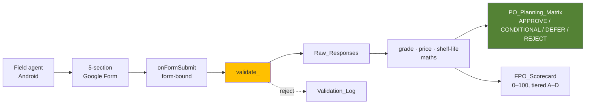

# Farmer Sourcing & Procurement Automation

**A multi-section Google Apps Script survey that field agents fill on a phone, and the aggregation layer that turns their answers into a purchase-order line with the commercial risk already flagged.**

The survey is the easy part. The value is in what comes after it.



---

## Start here

**You do not need a Google account to evaluate this.**

```bash
python samples/generate_samples.py            # -> sample outputs, no credentials
python -m unittest discover -s samples        # 50 tests
```

Both run offline on **Python 3.9+** (tested on 3.13) and no third-party
packages. This reproduces the PO planning matrix, FPO scorecard and pipeline
summary exactly as the Apps Script would produce them, because
`samples/generate_samples.py` is a line-for-line mirror of the commercial logic
in `src/`.

To run the real thing on Google infrastructure you need a Google account — see
[Setup](#setup). It takes about five minutes.

## What it does

A sourcing agent visits a Farmer Producer Organisation, checks the standing
crop, and submits one form per commodity. On submit, the pipeline:

1. **Validates** the row — grade shares must sum to 100% ±10, quantities and
   prices must be positive, distance must be servable. Rejections go to a log
   with a reason, not silently into the aggregate.
2. **Grades the lot.** Grade A is a 1.00 yield, B 0.75, C 0.45 — so 100%
   Grade C is worth 0.45, not the 1.00 a naive average of shares would give.
3. **Applies three haircuts in order** — confidence (the estimate is a
   judgement, not a weighbridge), grade yield, then field loss.
4. **Aggregates to ISO week × commodity × FPO**, which is the grain a
   purchase order is actually written at.
5. **Flags the commercial risk** and issues a decision.

On the sample field, 54 responses across 7 FPOs produce 25 planning lines for
one week: **15,696 kg feasible at ₹3,84,236**, split 9 approve / 12 conditional
/ 3 defer / 1 reject.

---

## The three decisions worth reviewing

### The margin test must not grade the FPO's quote against itself

The obvious check — "is the asking price inside our target margin?" — is
circular. Derive retail from the quote and every price passes.

So the reference is built from an **independent** input: today's mandi rate
for that commodity, times the category's normal mandi-to-retail spread. The
test can then actually fail, and an FPO quoting 15% over the local mandi rate
gets flagged regardless of what our own arithmetic would have said.

```
retail_reference = mandi_rate × spread(category)     # 1.22 bulbs … 2.10 leafy
cost_to_retail   = fpo_quote / retail_reference      # breach above 74%
```

### The trigger context is asserted, not assumed

`onFormSubmit` has two incompatible contexts. Installed from the **Form**,
the event carries `e.response`. Installed from the **Sheet**, it carries
`e.namedValues` and `e.response` is `undefined`.

Getting this wrong does not fail on line one — it fails on the first
`e.response` access, after a real submission has been lost, and trigger
failures are invisible to the person who submitted. So `installTrigger()`
installs from the form and then reads the trigger back to assert
`getTriggerSourceId() === form.getId()`. The handler also checks for a missing
`e.response` and writes a `FATAL` line naming the fix.

### Quality gates the decision before price does

A cheap lot from an FPO with a 25% field-loss rate is not cheap — the loss
just arrives later, in the dark store, as shrinkage. So `sourcingDecision()`
checks quality, logistics and harvest readiness *first*:

| Signal | Decision |
| --- | --- |
| Not harvest-ready | `DEFER` — plan next cycle |
| Cost-to-retail above ceiling | `REJECT` — margin breach |
| Grade-A below 55%, or field loss above 8% | `CONDITIONAL` — trial order with the fix attached |
| Cost-to-retail within 6pp of the ceiling | `CONDITIONAL` — negotiate before PO |
| Price above mandi **and** crate-dependent | `CONDITIONAL` — price and crate risk |
| Price above mandi only | `APPROVE WITH NEGOTIATION` |
| Clean | `APPROVE` |

A low grade never rejects an FPO outright. It reduces the commitment and
attaches a fix, because the grade is a remediable problem.

---

## Files

| File | Role |
| --- | --- |
| `src/Config.gs` | Every tunable: sheet names, question titles, grade yields, shelf-life table, decision thresholds |
| `src/Utils.gs` | Pure calculation helpers — no `SpreadsheetApp`, no `FormApp` |
| `src/FormBuilder.gs` | Builds the five-section form, and the menu |
| `src/TriggerHandler.gs` | Form-bound `onFormSubmit`, validation, trigger install + assertion |
| `src/Aggregator.gs` | PO matrix, FPO scorecard, dashboard |
| `appsscript.json` | Manifest — V8, the four scopes needed |
| `samples/generate_samples.py` | Python mirror of the commercial logic |
| `samples/test_sourcing_logic.py` | 50 tests |
| `samples/*.csv`, `pipeline_summary.json` | Sample outputs, regenerated by the script |
| `docs/architecture-flowchart.md` | Full diagram, data grain, operating cadence, limitations |

---

## Setup (requires a Google account)

Everything here runs inside Google's Apps Script runtime. There is no local
install and nothing to configure beyond two IDs.

1. Go to [script.google.com](https://script.google.com) and create a project.

2. Add the five files from `src/` to the editor. Apps Script will not accept a
   pasted file upload, so create one `.gs` per file and paste each one's
   contents in:

   | file | paste into a file named |
   | --- | --- |
   | `src/Config.gs` | `Config.gs` |
   | `src/Utils.gs` | `Utils.gs` |
   | `src/FormBuilder.gs` | `FormBuilder.gs` |
   | `src/TriggerHandler.gs` | `TriggerHandler.gs` |
   | `src/Aggregator.gs` | `Aggregator.gs` |

   The names matter: the files reference each other's globals by name, and the
   trigger installer looks up `onFormSubmit` by that exact name.

3. Copy `appsscript.json` into **Project Settings → Show "appsscript.json"**.

4. Run `setupSpreadsheet()` once from the editor. Google will ask to authorise;
   approve it. The spreadsheet ID is printed to the execution log — open it via
   **Executions** in the left panel.

5. Put that ID into `Config.gs` as `SPREADSHEET_ID`, replacing the
   `REPLACE_WITH_YOUR_SPREADSHEET_ID` placeholder. This is required because
   the form and its response sheet are separate Drive objects, so the script
   cannot use `getActiveSpreadsheet()`.

6. Run, in order: `buildSurvey()` → `installTrigger()` → `rebuildPoMatrix()`.

   `installTrigger()` installs the trigger from the **Form**, then reads it back
   and asserts its event source. If you see `FATAL: ... must be installed from
   the Form, not the Sheet` in the log, you installed it from the wrong
   project — delete the trigger and re-run from the form's script editor.

**Sharing.** Give the form link-access, responder only. Share the tracking
**spreadsheet** with sourcing staff only — the FPO scorecard is internal.

---

## Verifying without a Google account

Apps Script only runs in Google's runtime, which makes the commercial logic
awkward to review and impossible to test in CI. So `samples/generate_samples.py`
mirrors `Config.gs` + `Utils.gs` + `Aggregator.gs` line for line — same
constants, same order of operations, same thresholds — and regenerates the
sample outputs:

```bash
python samples/generate_samples.py
python -m unittest discover -s samples -v
```

This is not a convenience. The test suite caught a real bug: `gradeIndex()`
clamped each grade share individually but not their sum, so an agent reporting
120% Grade A produced a yield above 1.0 and an order larger than their own
harvest estimate. Fixed in both implementations, and the clamp is now pinned
by a test.

Two other tests exist for language-level reasons rather than logic:

- **Rounding.** Python rounds half-to-even, JavaScript rounds half-away-from-
  zero. `round(0.5)` is `0`; `Math.round(0.5)` is `1`. A half-rupee difference
  per line across thousands of lines is a real reconciliation gap.
- **Week start.** `date.weekday()` and `getDay()` disagree about which end of
  the week they start, and Sunday must map to the *previous* Monday.

---

## Sample output

`po_planning_matrix_sample.csv`, week of 2026-10-05:

| commodity | fpo_id | grade_adj_kg | price ₹/kg | cost-to-retail | decision | flags |
| --- | --- | --- | --- | --- | --- | --- |
| Carrot | FPO-MDY-01 | 399.1 | 31.86 | 79.1% | **REJECT** | margin breach · low Grade-A · above mandi · long transit |
| Banana | FPO-HSR-01 | 670.2 | 24.86 | 72.9% | **CONDITIONAL** | low Grade-A · high field loss · above mandi · crate dependent |
| Bottle Gourd | FPO-CBK-02 | 364.7 | 19.77 | 67.1% | **APPROVE** | crate dependent |

Read the Carrot line: it is rejected at 79.1% cost-to-retail, and it is
rejected *because* the quote is 15% over the local mandi rate for a
fourth-grade lot at 96 km. Nothing in the FPO's own numbers would have
produced that verdict on their own.

`fpo_scorecard_sample.csv` tiers the seven FPOs A–D, with an action string per
tier. Note the score is a *composite*: a cheap but inconsistent FPO can
outscore a consistent but dear one, which is intentional — the score is a
screening tool, not a verdict.

---

## Requirements

| path | needs |
| --- | --- |
| `samples/` (offline mirror + tests) | Python 3.9+, standard library only — no pip install |
| `src/` (the real pipeline) | A Google account. No pip, no Node, no local server. |

## Licence

MIT — see [LICENSE](LICENSE).

Mandi benchmark rates in `Config.gs` reference publicly reported All-India
figures for October 2026. All field responses in `samples/` are synthetic.

---

## Related projects

Three companion projects on the same problem — how much of the gap between
farm-gate cost and shelf price is recoverable in Indian F&V retail. They share
a commodity master, a lane (Bengaluru PC → dark store, 62 km), and a set of
grounded price and loss benchmarks. Each is a standalone repository; clone
only the one you want.

| project | question it answers | try it |
| --- | --- | --- |
| [mandi-margin-simulator](https://github.com/kv9515561091-ux/mandi-margin-simulator) | On any given day, is this line still worth buying? Node CLI, zero dependencies | `git clone https://github.com/kv9515561091-ux/mandi-margin-simulator.git && cd mandi-margin-simulator && node src/index.js simulate --days 30 --seed 99` |
| [fv-shrinkage-dashboard](https://github.com/kv9515561091-ux/fv-shrinkage-dashboard) | Why is stock being written off, and would enforcing rotation fix it? A counterfactual re-simulation attributes **57.3% of expiry** to FEFO failure | `pip install -r requirements.txt && python scripts/generate_data.py && python scripts/analyze.py` |
| [transit-spoilage-anova](https://github.com/kv9515561091-ux/transit-spoilage-anova) | Which handling method extends shelf life? Finds that onions must **not** be chilled — worth ₹28.6 lakh/year on one lane | `pip install -r requirements.txt && python analysis/generate_experiment.py && python analysis/anova_analysis.py` |

The connection worth noting: this project flags a FPO's quote using an
**independent** denominator — today's mandi rate, not a retail price derived
from the quote itself — and the simulator it links to above carries that same
rule. Both are deliberate refusals to let a number grade itself, and getting
either wrong silently approves any price.
