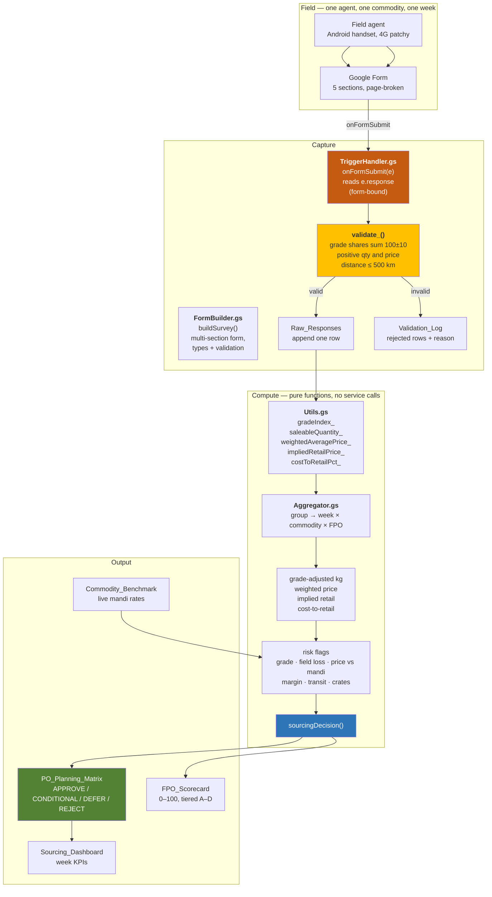

# System architecture

How a field agent's phone submission becomes a purchase-order line a buyer can
act on.



## The three decisions that shape this design

### 1. The form is sectioned, not long

A 40-field single-page form is unusable on a ₹6,000 Android handset on rural
4G. Five page breaks turn a submission that would be abandoned mid-way into
a partial one that is still useful — a farmer who cannot answer the pricing
section can still get their harvest volume into the plan.

Every question carries a help string that states *why the answer matters*
("Over-estimating here is the single most common cause of a rejected load").
An agent who understands the consequence answers more honestly, which is the
only input the whole pipeline depends on.

### 2. The trigger context is asserted, not assumed

There are two `onFormSubmit` contexts and they are not interchangeable:

| Installed from | Event object | Has `e.response`? |
| --- | --- | --- |
| The **Form**'s script editor | `FormResponse` | yes |
| The **Sheet**'s script editor | `{values, namedValues}` | **no** |

Getting this wrong does not fail on line one. It fails later, on the first
`e.response` access, as `Cannot read properties of undefined` — and by then a
real submission has been lost, silently, because trigger failures are
invisible to the person who submitted.

`installTrigger()` therefore installs from the form, then reads the created
trigger back and checks `getTriggerSourceId() === form.getId()`. `onFormSubmit`
also checks for a missing `e.response` and writes `FATAL: ... must be installed
from the Form` to the log, so the mistake is diagnosable rather than silent.

A second constraint rides along with this: it must be an **installable**
trigger. Simple triggers cannot reach `SpreadsheetApp`, and every failure path
is wrapped in `try/catch` with the error written to `Validation_Log` — because
nobody sees a trigger's stack trace.

### 3. The margin test must be independent of the quote

The obvious check is "is the FPO's asking price below our target margin?"
That is circular: deriving retail from the quote and then testing the quote
against it approves any price.

So the reference is built from an **independent** input — today's mandi rate
for that commodity, times the category's normal mandi-to-retail spread:

```
retail_reference = mandi_rate × spread(category)
cost_to_retail  = fpo_quote / retail_reference
```

Now the test can actually fail, and a FPO quoting 15% over the local mandi
rate gets flagged regardless of what our own margin arithmetic would have
said about it.

## Data flow and grain

| Stage | Grain | Why |
| --- | --- | --- |
| Form response | one commodity × one FPO × one survey date | one form per commodity per FPO per week |
| `Raw_Responses` | same | append-only audit trail |
| `PO_Planning_Matrix` | **ISO week × commodity × FPO** | the grain a purchase order is written at |
| `FPO_Scorecard` | FPO | supplier review cadence is monthly, not weekly |

Aggregating at the response level would produce a sheet nobody can act on;
aggregating at FPO level would hide the commodity mix that makes a supplier
worth scaling.

## Rebuild strategy: full, not incremental

Every submission triggers a **full** rebuild of all three derived tables.
A full rebuild of a few thousand rows costs well under a second and removes
an entire class of bug: incremental aggregation drifts whenever a record is
corrected or rejected, and nobody notices until a purchase order is wrong.

The latency column in the dashboard reports this as 0 seconds, which is the
honest answer for a dataset this size — not a boast.

## Where the commercial logic lives

`Utils.gs` and `Aggregator.gs` contain no `SpreadsheetApp` or `FormApp`
calls. That separation is what allows `samples/generate_samples.py` to mirror
the arithmetic exactly, so the logic can be reviewed and tested in CI without
a Google account.

`samples/test_sourcing_logic.py` — 50 tests — pins the behaviour where a
wrong answer costs money:

- grade index can never exceed 1.0, whatever shares are reported
- 100% Grade C yields 0.45, not the 1.0 a naive mean of shares would give
- the retail price really does invert to the target margin
- a missing harvest is `None`, not `0` — they imply opposite decisions
- the quality threshold fires on *some* lines and not all of them
- a full rebuild is idempotent

The Rounding test is there for a specific reason: Python rounds half-to-even,
JavaScript rounds half-away-from-zero. `round(0.5)` is `0` and
`Math.round(0.5)` is `1`, and a half-rupee difference per line across
thousands of lines is a real reconciliation gap between the two
implementations.

## Operating the pipeline

```
MORNING   overwrite Commodity_Benchmark with today's mandi rates
          -> this is what makes the margin test non-circular

TRIGGERED agent submits -> validate -> append -> full rebuild (< 1s)

WEEKLY    read PO_Planning_Matrix, filtered to APPROVE + CONDITIONAL
          raise purchase orders from the CONDITIONAL lines first

MONTHLY   review FPO_Scorecard
          promote A-tier, put C-tier on a remediation plan,
          suspend D-tier
```

## Known limitations

- **Rate of change is not modelled.** The survey is a point-in-time snapshot;
  a mandi price that moves 20% in a day will not be seen until the next survey
  cycle. In production this wants a daily rate feed feeding
  `Commodity_Benchmark` directly, not an agent reading a board.
- **The estimate-reliability signal needs history.** `ESTIMATE_CONFIDENCE` is
  the agent's own judgement. The scorecard's `on_time_pct` only becomes
  meaningful after several weeks of responses per FPO; a first-week scorecard
  is directionally right but statistically thin.
- **No offline capture.** The form requires connectivity. A field agent in a
  low-signal village either waits or skips the survey. The fix is a
  `google.script.run`-backed local cache, which was out of scope here.
- **Post-harvest loss is self-reported.** It is the input the whole
  conditional-approval path depends on, and it is the one most likely to be
  optimistic. A physical audit of two or three lots per quarter is the only
  way to calibrate it.
